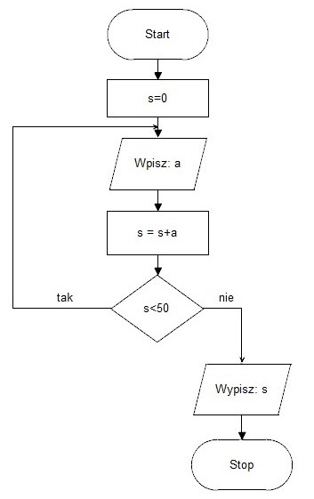
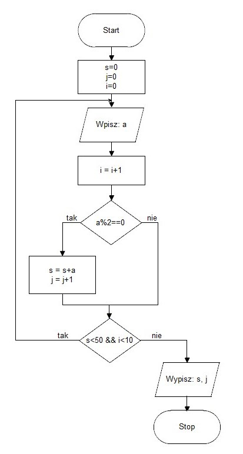
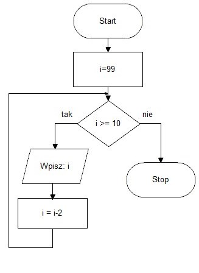

# Algorytmy iteracyjne - przykłady

## Przykład 1

**Specyfikacja algorytmu:**

Problem algorytmiczny: Wczytywanie liczb i sumowanie ich dopóki suma nie osiągnie 50

Dane wejściowe: a - liczba rzeczywista

Dane wyjściowe: s - liczba rzeczywista

**Algorytm:**

## Przykład 2

**Specyfikacja algorytmu:**

Problem algorytmiczny: Wczytywanie liczb i sumowanie parzystych dopóki suma nie osiągnie 50 lub nie zostanie wczytanych 10 liczb. Wypisanie sumy i ilości liczb zsumowanych.

Dane wejściowe: a - liczba rzeczywista

Dane wyjściowe: s - liczba rzeczywista, j - liczba naturalna

Zmienne pomocnicze: i - liczba naturalna

**Algorytm:**

## Przykład 3

**Specyfikacja algorytmu:**

Problem algorytmiczny: Wypisanie liczb dwucyfrowych nieparzystych w sposób malejący

Dane wejściowe: brak

Dane wyjściowe: Malejący ciąg liczb dwucyfrowych nieparzystych

**Algorytm:**

