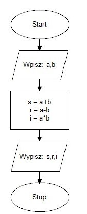
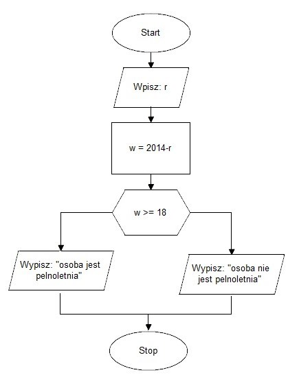
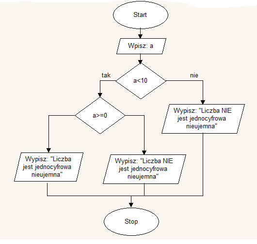

# Algorytmy liniowe i warunkowe - przykłady

## Algorytm liniowy

**Specyfikacja problemu algorytmicznego:**

Problem: Dla dwóch wczytanych liczb znalezienie ich sumy różnicy (pierwsza - druga) i iloczynu

Dane wejściowe: a,b - liczby rzeczywiste

Dane wyjściowe: s,r,i - liczby rzeczywiste

**Algorytm (lista kroków)**

1. Wczytaj a,b

2. Oblicz s = a+b

3. Oblicz r = a-b

4. Oblicz i = a\*b

5. Wypisz s,r,i

**Algorytm (schemat blokowy)**

## **Algorytm warunkowy**

**Specyfikacja problemu algorytmicznego:**

Problem algorytmiczny: Znając wiek osoby sprawdzenie, czy jest pełnoletnia.

Dane wejściowe: r - liczba naturalna

Dane wyjściowe: Informacja o tym, czy osoba jest pełnoletnia

Zmienne pomocnicze: w - liczba naturalna

**Algorytm (lista kroków)**

1. Wczytaj r

2. Oblicz w różnicę między bieżącym rokiem, a r

3. Jeśli w &gt;=18 to wypisz "osoba jest pełnoletnia", w przeciwnym razie wypisz "osoba nie jest pełnoletnia"

**Algorytm (schemat blokowy)**

## **Algorytm warunkowy przykład trudniejszy**

**Specyfikacja problemu algorytmicznego:**

Problem algorytmiczny: Sprawdzenie, czy wczytana liczba jest jednocyfrowa nieujemna.

Dane wejściowe: a - liczba rzeczywista

Dane wyjściowe: Informacja o tym, czy liczba jest jednocyfrowa nieujemna

**Algorytm (lista kroków)**

1. Wczytaj a

2. Sprawdź, czy a&lt;10, jeśli tak przejdź do kroku 3, jeśli nie przejdź do kroku 4.

3. Sprawdź, czy a&gt;=0, jeśli tak, to wypisz, że liczba jest jednocyfrowa nieujemna i zakończ algorytm, jeśli nie to przejdź do kroku 4.

4. Wypisz, że liczba nie jest jednocyfrowa nieujemna i zakończ algorytm.

****Algorytm (schemat blokowy)****

