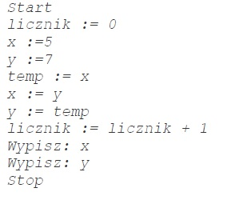
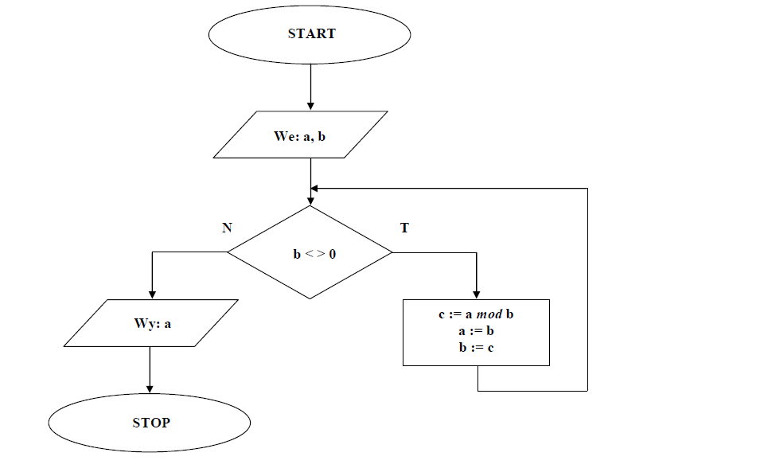
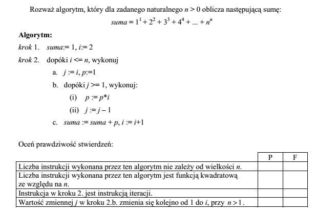

# Analiza gotowych algorytmów

**Zadanie 1.** Przeanalizuj poniższą listę kroków i podaj efekt jej działania. Jaka będzie wartość wszystkich zmiennych po zakończeniu algorytmu.

**Zadanie 2**. Przeanalizuj poniższy schemat blokowy i podaj efekt jego działania (np dla a=15, b=6).

**Zadanie 3**

