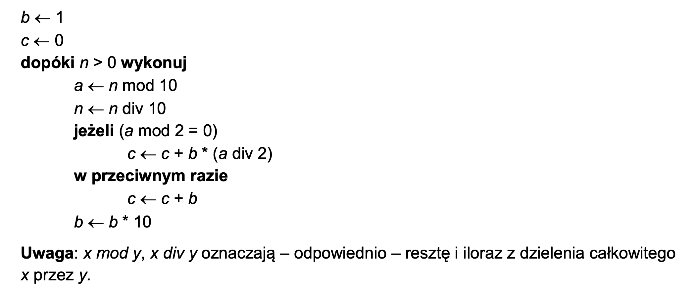
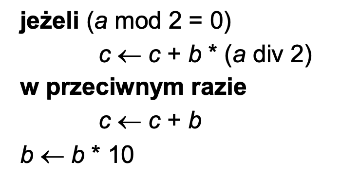

# Pseudokod

Pseudokod to jeden ze sposobów zapisu algorytmu, czytelny i zrozumiały, z dość luźnymi regułami zapisu; powszechnie stosowany na maturze z informatyki.

**Przykład - matura 2024, zad. 2**

**Zasady tworzenia pseudokodu:**

1. Nie ma deklaracji zmiennych
2. Nie ma potrzeby wczytywania kodu - opis wczytywanych danych znajduje się w specyfikacji
3. Nie ma określonych reguł składniowych, np:
   - Poprawne jest przypisanie `a:=1,` a także `a=1`, i jeszcze `a<-1`
   - Poprawny jest zarówno zapis `a=b mod c`, jak i `a = b % c`
4. Wcięcia <u>mają</u> znaczenie, np:  
     
     
     
   *Instrukcja c=c+b zostanie wykonana tylko wtedy, kiedy warunek a mod 2 = 0 nie będzie prawdziwy (czyli "w przeciwnym razie"). Instrukcja b=b\*10 zostanie wykonana zawsze, bez względu na warunek, gdyż nie jest wcięta, wobec tego nie zależy od warunku.*
5. Pętle możemy zapisywać na kilka sposobów:  
   1. powtarzaj  
        x=x+1  
          `y=y-1`  
      aż x=10
   2. `dopóki a!=0 wykonaj`  
       `n=n+10`  
       `a=a-n`
   3. `dla x= 0,1,...n:`  
       `suma=suma+x`
   4. `dla każdego x= 0,1,...n wykonuj`  
       `suma=suma+x`
6. Funkcje możemy zapisać np. tak  
     
   `funkcja pole(a,b)`  
    `p=a*b`  
    `zwróć p`  
     
   lub możemy pominąć słowo "funkcja"
