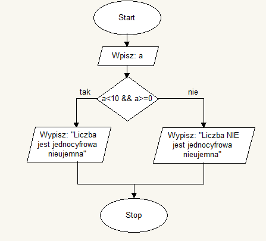
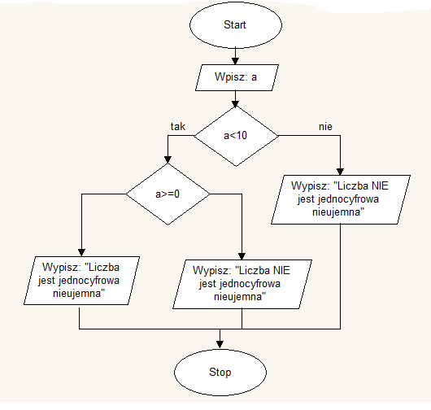

# Schematy blokowe - ważne uwagi

## Realizacja operacji przypisania w bloku operacyjnym

Możemy spotkać kilka zapisów:

- obw **:=** 4\*a
- obw **=** 4\*a
- obw ← 4\*a

Wszystkie zapisy są poprawne, zależą one od preferencji (programistycznych) twórcy algorytmu. My wybieramy sposób pole **=** 4\*a, ponieważ taki zapis jest poprawny w C++ - używanym u nas języku programowania. Należy umieć czytać wszystkie zapisy, bo na maturze każdy z nich może się pojawić.

## Budowanie warunków w bloku warunkowym.

Do budowania prostych warunków potrzebujemy operatorów relacyjnych: &gt;, &lt;, &gt;=, &lt;=, == (operator równości, w pascalu =), != (operator różności, w pascalu &lt;&gt; )

Do budowania warunków złożonych potrzebujemy operatorów logicznych:

- koniunkcja: && (and)
- alternatywa: || (or)
- zaprzeczenie: ! (not)

**Częste warunki w praktyce szkolnej:**

a%2==0 - sprawdzenie, czy liczba jest parzysta (w pascalu a mod 2 = 0)  
a%2!=0 - sprawdzenie, czy liczba nie jest parzysta (w pascalu a mod 2 &lt;&gt; 0)  
a&gt;=0  &&  a&lt;=5  - sprawdzenie, czy liczna jest w przdziale [0,5]  
a&lt;=0  ||  a&gt;=5 - sprawdzenie, czy liczba jest w przdziale (-niesk,0] suma [5,+niesk)

Uwaga - Warunek złożony można zastąpić zagnieżdżaniem warunków prostych (co bywa często optymalniejszym rozwiązaniem)

Poniższe dwa algorytmy rozwiązują ten sam problem. Sposób z dwoma warunkami prostymi jest optymalniejszy, bo dla liczb dużych dodatnich wykonuje się tylko jedno porównanie, a alternatywny sposób zawsze wykonuje dwa porównania

## Poprawne tworzenie specyfikacji

Dopuszczalne zapisy w specyfikacji:

- a,b - liczby rzeczywiste, a ≠ 0, b ≠ 0
- a,b - liczby rzeczywiste, różne od zera
- a ∈ R \ {0}, b ∈ R \ {0}
- Można dodatkowo podać opis zmiennej np a - liczba rzeczywista różna od zera (pierwsza liczba podana przez użytkownika)
