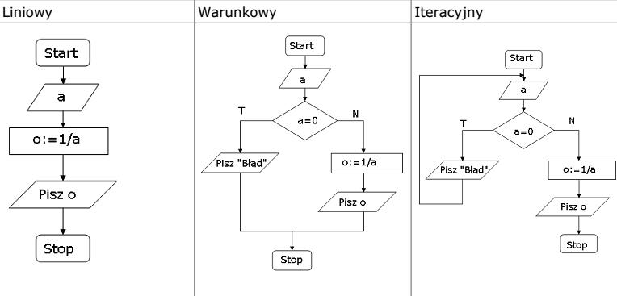

# Wstęp do algorytmiki - teoria

**Problem algorytmiczny** - problem, zadanie dla którego da się ustalić rozwiązanie.

**Przykłady problemów algorytmicznych**:

- Znalezienie pola kwadratu znając jego bok
- Upieczenie babki

**Przykład problemu NIE algorytmicznego:** Namalowanie obrazu, który osiągnie sukces

**Specyfikacja problemu algorytmicznego** - Podanie problemu/zadania do rozwiązania oraz określenie danych wejściowych i wyjściowych, a także ewentualnych zmiennych pomocniczych. Podając dane wejściowe i wyjściowe podajemy symbol zmiennej i jej typ. Przykład niepoprawnego i poprawnego podawania danych:

- a - bok kwadratu
- a - liczba rzeczywista
- a - liczba rzeczywista (bok kwadratu) -&gt; w tej sytuacji podaliśmy typ (niezbędny w specyfikacji) i opis zmiennej

**Algorytm** - skończony ciąg czynności, przekształcający zbiór danych wejściowych na zbiór danych wyjściowych (wyników)  
  
**Sposoby zapisu algorytmu**

- Zapis w postaci opisu słownego
- Zapis w postaci listy kroków
- Zapis w postaci graficznej - schematy blokowe
- Zapis w języku symbolicznym, pseudokod
- Zapis w języku programowania

**Cechy algorytmu**

- ***Poprawny*** - dla każdego zestawu danych, po wykonaniu skończonej liczby czynności, prowadzi do poprawnych wyników,
- ***Jednoznaczny*** - w każdym przypadku jego zastosowania, dla tych samych danych uzyskamy ten sam wynik,
- ***Szczegółowy*** - aby wykonawca algorytmu rozumiał opisane czynności i potrafił je wykonać,
- ***Uniwersalny***, aby posłużył do rozwiązywania pewnej grupy zadań, a nie tylko jednego zadania (np. algorytm jest przepisem na rozwiązanie równania postaci ax+b=0 dla dowolnych współczynników a i b, a nie - jednego konkretnego równania, np. 2x+3=0.

**Schemat blokowy -**graficzne przedstawienie algorytmu, zbudowany z bloków

- graniczny - start, stop
- wejścia/wyjścia, i/o
- operacyjny, wykonywania działań
- warunkowy, decyzyjny

Dodatkowe "nietypowe" bloki

- blok podprogramu
- blok komentarza
- łącznik stronnicowy - gdy algorytm się nie mieści i trzeba go kontynuować w innym miejscu na tej samej stronie
- łącznik międzystronnicowy - gdy algorytm się nie mieści i trzeba go kontynuować na innej stronie
- blok kolekcyjny - łączy (kolekcjonuje) kilka dróg algorytmu

**Typy algorytmów**

- liniowy - sekwencyjne wykonywanie kolejnych instrukcji
- warunkowy - wykonywanie poszczególnych instrukcji w zależności od spełnienia lub niespełnienia warunku.
- iteracyjny - kilkakrotne powtarzanie tych samych instrukcji

**Pytanie:** Określ ile wejść i ile wyjść ma każdy blok schematu blokowego?

**W czym tworzyć schematy blokowe?**

Istnieje wiele płatnych i darmowych programów do tworzenia schematów blokowych, a także aplikacje chmurowe:

- Visio firmy Microsoft
- Diagram Designer
- [https://www.lucidchart.com/](https://www.lucidchart.com/ "https://www.lucidchart.com/")
- a także każda aplikacja do UML  (UML - *Unified Modeling Language*, czyli *Zunifikowany Język Modelowania*) ,
