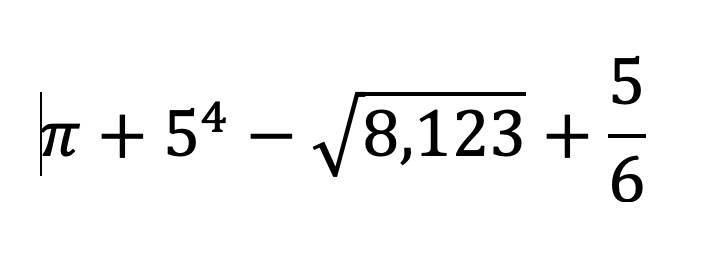

# Funkcje matematyczne - wykorzystanie  biblioteki

**Funkcje matematyczne (aby skorzystać dodajemy #include&lt;cmath&gt; )**

1. `sqrt(x)` -&gt; pierwiastek drugiego stopnia z x
2. `pow(x,y)` -&gt; podnieś x do potęgi y
3. `abs(x)` -&gt; wartość bezwzględna z x
4. `ceil(), floor(), round()` -&gt;zaokrąglanie (w gore, w dol, matematyczne)
5. `M_PI` -&gt; stała pi=3.14......

---

**Lista zadań:**

Wczytaj dwie liczby a i b, takie że b&gt;0.

1. Podaj wartość bezwzględną liczb;
2. Podnieś pierwszą liczbę do potęgi 3.
3. Oblicz pierwiastek z drugiej liczby.
4. Podnieś liczbę a do potęgi b.
5. Dokonaj zaokrąglenia w dół i w górę pierwszej liczby.
6. Załóż, że b to promień koła. Oblicz jego pole wykorzystując stałą pi.
7. Oblicz wyrażenie w jednej linii:  
   
