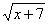

# if - lista zadań 1 - proste zadania na lekcje

1.Napisz następujący program: Użytkownik programu podaje 2 liczby całkowite większe od zera, a program wypisuje ich iloczyn, iloraz, sumę. Przed rozwiązaniem dokończ poniższe zdania:

- **1.** Suma dwóch liczb całkowitych jest liczbą …............................
- **2.** Iloczyn dwóch liczb całkowitych jest liczbą ….........................
- **3.** Iloraz dwóch liczb całkowitych jest liczbą …...........................
- **4.** Jeśli w C++ zmienna jest typu **całkowitego** to deklarujemy ją pisząc w kodzie programu: ….................................
- **5.** Jeśli w C++ zmienna jest typu **rzeczywistego** to deklarujemy ją pisząc w kodzie programu: ….................................

2.Narysuj SCHEMAT BLOKOWY oraz napisz PROGRAM w języku C++ dla następującego zadania:

Program wczytuje dwie liczby, a następnie sprawdza która z nich jest większa. Jeśli pierwsza wczytana liczba jest większa od drugiej, to obliczana jest różnica wczytanych liczb. Jeśli wczytane liczby są sobie równe lub pierwsza wczytana liczba jest mniejsza od drugiej, to program oblicza sumę wczytanych liczb.

3. Wczytaj liczbę całkowitą i wykonaj następujące zadania:

1. Sprawdź, czy jest dodatnia, czy nie jest dodatnia
2. Sprawdź, czy jest parzysta
3. Wczytaj drugą liczbę i sprawdź czy jest taka sama
4. Potraktuj pierwszą liczbę jako bok kwadratu, znajdź jego pole i obwód i wypisz wyniki. Pamiętaj, że bok kwadratu jest liczbą dodtanią
5. Znajdź liczbę odwrotną i przeciwną do wczytanej, pamiętaj, że nie można odwracać zera
6. Sprawdź, czy wczytana liczba jest dodatnia, ujemna czy jest zerem - program wykonaj optymalnie
7. Dla dwóch wczytanych liczb sprawdź, która z nich jest większa
8. Sprawdź, czy liczba należy do przedziału (-5,5)
9. Sprawdź, czy liczba należy do przedziału (-niesk,5) suma &lt;10;+niesk)

4. Napisz program wczytujący cztery znaki i sprawdzający ile z tych znaków jest gwiazdką.

**Zadania przekrojowe:**

1. Napisz program, który wczytuje 3 liczby a, b,c.
   - jeżeli liczba a jest równa jeden sumuje liczby b oraz c i wypisuje wynik
   - jeżeli liczba a jest równa trzy, to wypisuje wartość liczby c na ekranie
   - jeżeli c jest liczbą parzystą, to wypisuje wartość liczby a na ekranie
   - jeżeli c nie jest liczbą parzystą, to wypisuje wartość dzielenia liczby b przez a
2. Napisz program, który zamienia cyfry na słowa. Użytkownik podaje cyfrę np. 3, a program wypisuje zdanie: Podałeś liczbę trzy.
3. Napisz program, który oblicza wartości funkcji . (użytkownik podaje argument funkcji – x, a program oblicza wartość funkcji). Pamiętaj, że pod pierwiastkiem nie może być liczba ujemna. Funkcja sqrt wzmaga włączenia biblioteki cmath
4. Program wczytuje 3 liczby i
   - jeśli pierwsza nie jest równa 1 to wypisuje  \*,
   - jeśli druga jest równa 3 to wypisuje #,
   - jeśli trzecia jest mniejsza od 7 to wypisuje +++.
