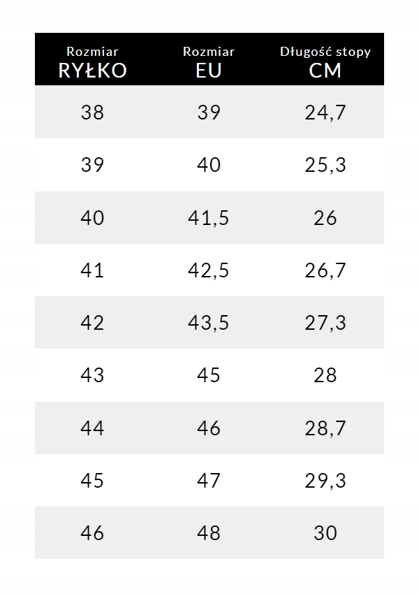

# Instrukcja warunkowa if - teoria

## Składnia instrukcji

```cpp
if (warunek) 
   instrukcja1;
else 
   instrukcja2;
```

gdy w if-ie lub po else wykonujemy więcej niż jedną instrukcję:

```cpp
if(warunek) {
   instrukcja1;
      instrukcja2;
   ....
}
else {
   instrukcja3;
       intrukcja4;
   ....
}
```

### Najczęstsze przykłady zastosowania:

```cpp
if (a%2==0) cout<<"liczba parzysta"; else cout<<"liczba nieparzysta";
if (a%2!=0) cout<<"liczba nie parzysta"; else cout<<"liczba parzysta"; //lub if(a%2) cout<< "liczba nie parzysta"; else...
if ( a>=0 && a<=5 ) cout<<"w przdziale [0,5]";
if ( a<=0 || a>=5 ) cout<<"w przdziale (-niesk,0] suma [5,+niesk)";
char znak='t';
 if(znak>='a' && znak<='z') cout << "znak jest mała literą";
```

### Ważne! Używanie instrukcji warunkowej zagnieżdżonej:

Przykład:   
W zależności od długości stopy wybierz odpowiedni rozmiar. Załóżmy, że obsługujemy buty w rozmiarze 38-43 (rozmiar Rylko, pierwsza kolumna):



- (1) prawidłowe rozwiązanie:

```cpp
if (stopa<25.3)
    cout<<"rozmiar 38, mniejszego nie mamy";
else if(stopa<26)
    cout<<"rozmiar 39";
else if(stopa<26.7)
    cout<<"rozmiar 40";
else if(stopa<27.3)
    cout<<"rozmiar 41";
else if(stopa<28)
    cout<<"rozmiar 42";
else
    cout<<"rozmiar 43", większego nie mamy;
```

- (2) nieprawidłowe rozwiązanie:  
    
  `if (stopa<25.3)`  
   `cout<<"rozmiar 38, mniejszego nie mamy";`  
   `if(stopa<26 and stopa>25.3)`  
   `cout<<"rozmiar 39";`  
  `if(stopa<26.7 and stopa>26)`  
   `cout<<"rozmiar 40";`  
  `if(stopa<27.3 and stopa>26.7)`  
   `cout<<"rozmiar 41";`  
  `if(stopa<28 and stopa>27.3)`  
   `cout<<"rozmiar 42";`  
  `if(stopa>28)`  
   `cout<<"rozmiar 43", większego nie mamy;`  
    
  Rozwiazanie (2) jest nieoptymalne, ponieważ wymusza na kompilatorze zadanie wielu dodatkowych pytań o warunek. Przykładowo, dla stopy o długości 25cm w pierwszym rozwiązaniu wystarczy zadać 1 pytanie; w drugim - 10 pytań (kompilator po odpowiedzi na pierwsze musi jeszcze obsłużyć każde z kolejnych instrukcji warunkowych.

---

## Operator warunkowy ?:

Instrukcję if else możemy zastąpić operatorem trójargumentowym ?: Wyrażenie:   
  
`zmienna = (warunek) ? x : y ;`

jest tożsame z:

```cpp
if (warunek)
   zmienna = x;
else
   zmienna = y;
```
