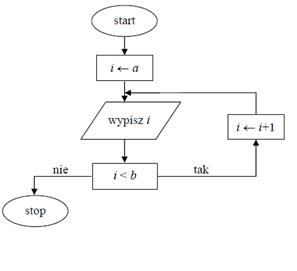

# Pętle - przykładowe pytania testowe, analiza kodu

1. Stwierdzenie, że zapętlona instrukcja wykonuje się co najmniej raz, dotyczy pętli:   
 a) for   
 b) do .. while   
 c) while   
 d) każdej z powyższych

2.Ile razy zostanie wypisany na ekran napis EXTRA?

```cpp
a)  for(j=0;j<8;j+=3) cout<<”EXTRA”;   ……………………………………………
b)  for(i=10;i>0;i-=4) cout<<”EXTRA”;  ……………………………………………
c)  int i=3;
    while(i%3==0){
                   cout<<”EXTRA”;
                   i+=3;
                 }                    ……………………………………………
```

3. Co będzie wynikiem wykonania poniższego fragmentu kodu?

```cpp
x=6;
while(x>0) cout<<--x+5;
```

4. Jakie liczby wyświetli poniższa instrukcja w języku ANSI C?

```cpp
for(n=1; n<10; n++)
    if((n % 2)!=0)
          cout<<n;
```

5. Dane są liczby całkowite a, b takie że b&gt;a oraz schemat algorytmu (uwaga skrzynka warunkowa ma zły kształt-błąd był na maturze):



Wynikiem działania tego algorytmu jest wypisanie:

a)      liczb parzystych z przedziału &lt;a,b&gt;

b)      liczb nieparzystych z przedziału (a,b)

c)      wszystkich liczb z przedziału &lt;a,b&gt;

d)     wszystkich liczb z przedziału (a,b)

6. Jaka to pętla? ……………………….

7. Ile razy wykona się poniższa pętla?

```cpp
for(n=5;n<=5;n+=2);
```

a)      0             b) 1      c) 2      d) 5

8 Po wykonaniu poniższej instrukcji w języku C wartość zmiennej n będzie wynosiła:

```cpp
n=1;
for(n=4; n<10;n++)
    {if(n!=4) continue;}
```

a)1       b) 4       c)10        d)9

9. Przedstawiona poniżej instrukcja w języku ANSI C wyświetli na ekranie ciąg

```cpp
for(int x=0; x<=7; x++)
     cout << x / 3;
```

1. liczb rzeczywistych
2. zer, jedynek, dwójek i trójek
3. zer, jedynek  i dwójek
4. zer i jedynek

10. Przeanalizuj fragment kodu i wskaż zdanie prawdziwe

```cpp
   i=4;
   for(;;i+=1)
        if(i==8) break;
```

a)      fragment jest błędny składniowo

b)      pętla jest  nieskończona

c)      po zakończeniu pętli zmienna i będzie wynosić 8

d)     po zakończeniu pętli zmienna i będzie wynosić 9

11. Ile razy wykona się poniższa pętla?

```cpp
for(i=1;i>10;i++)
  { cout<<i;}
```

12. Jaką wartość wypisze na ekranie program po wyjściu z pętli?

```cpp
for(int k=0;k<10;k++)
  {cout<<k;} cout<<k;
```

14. Dla jakiej wartości zmiennej y, program wyjdzie z pętli?

```cpp
int y=3;
do{
y--;
}while(y);
```

15. Czy któraś z poniższych instrukcji jest nieprawidłowa?

- `for(;;);`
- `int y=3; for(int i=1;i<5;i++,y--);`
- `int i=0; for(;;i++);`
- `for(int i=1,int j=1;;);`

16. Przeanalizuj kod i określ co zostanie wypisane:

```cpp
for(int i=0;i<5;i+=2){
     for(j=3;j>=i;j--)
            cout << "*";
     cout << endl;
}
```
