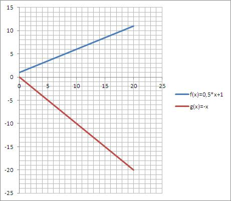

# Zadania tekstowe wykorzystujące pętle

1. Wiemy, że na wykonie płotu mamy 400 m siatki. Płot powinien być prostokątem, ewentualnie kwadratem, takim, że najkrótszy bok powinien wynosić co najmniej 10m.  Ważne jest, by wymiary płotu były liczbą całkowitą. Dobierz tak wymiary płotu, by pole ogrodzonej powierzchni było największe.
2. Przez F(C) oznaczamy figurę narysowaną w kartezjańskim układzie współrzędnych, która jest ograniczona przez:

- Oś OY z lewej strony
- Prostą o równaniu x = C z prawej strony,
- Krzywą o równaniu f(x) = 0.5\*x+1 od góry
- Krzywą o równaniu g(x)= -x od dołu

Poniżej przedstawiony jest przybliżony rysunek figury F(20).

Wyznacz taką najmniejszą liczb naturalną C żeby we wnętrzu figury F(C) (brzeg zaliczamy do wnętrza figury) można było umieścić prostokąt o wymiarach 100x15 w taki sposób, aby współrzędne wierzchołków były liczbami całkowitymi, a boki prostokąta były równolegle do osi OX i OY, przy czym dłuższe boki powinny być równolegle do osi OX. Podaj wartość C i wierzchołki prostokąta.

Uwaga: Do wykonania tego zadania  musisz użyć funkcji abs(), która znajduje wartość bezwzględną z liczby oraz funkcję floor() zaokroąglającą liczbę  dół. Obie są dostępne po zaincludowaniu biblioteki &lt;cmath&gt;
