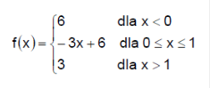

# Podprogramy - zadania 1

1. W programie głównym wczytaj dwa boki dla prostokąta, następnie napisz następujące funkcje:
   - czy\_kwadrat(), która sprawdza, czy prostokąt jest kwadratem
   - pole() - obliczająca pole kwadratu
   - obwod() - obliczająca obwód kwadratu
2. Napisz funkcję szlaczek(), która przyjmie dwa parametry: n-liczbę znaczków w szlaczku oraz z-z jakiego znaczka ma być złożony szlaczek. Funkcja ma rysować szlaczek, np dla n=10 i z='\*' ma powstać szlaczek: \*\*\*\*\*\*\*\*\*\*
3. Napisz funkcję, która obliczy wartość funkcji y=2x\*x-1 dla x podanego jako parametr
4. Napisz funkcję obliczającą wartość funkcji f(x) dla wczytanego argumentu x, gdzie 
5. W tym zadaniu sam zdecyduj na jakie funkcje ma być podzielony program. W programie głównym wczytaj 3 boki trójkąta, a następnie napisz funkcje, w których zrealizujesz następujące zadania: znajdowanie pola (wzór Herona), obwodu, sprawdzanie czy jest to w ogóle trójkąt, sprawdzanie, czy jest prostokątny, czy jest równoboczny, (\*) znalezienie długości podstawy opadającej na każdy z boków.
6. Napisz funkcję o nazwie **kalkulator**, która będzie pobierała trzy argumenty: dwie liczby i znak. Jeśli wczytanym znakiem jest + liczby są dodawane, jeśli – program odejmuje liczbę mniejszą od większej, jeśli \* liczby są mnożone, jeśli / liczba pierwsza jest dzielona przez drugą (uwaga – nie dziel przez zero).
7. Napisz funkcję, która będzie wyświetlała wszystkie liczby całkowite nieparzyste czterocyfrowe.
8. Napisz funkcję, która będzie obliczała wartość wyrażenia (x+2y-z)/(0.5x)-8, gdzie x, y, z są liczbami całkowitymi. Następnie wywołaj tą funkcję dla x=4, y=5, z=-3.
9. Napisz funkcję o nazwie waluty. Jej zadaniem będzie zamiana złotówek (podanych jako parametr funkcji) na:

Dolary - jeśli jako drugi parametr funkcji podamy  znak '$'

Euro  - jeśli jako drugi parametr funkcji podamy  literę E

Franki - jeśli jako drugi parametr podamy literę F.

           Przykład:  
                  cout&lt;&lt;waluty(100, '$')     //na ekran powinno wypisać 26 przy zalożeniu że 1$ kosztuje 3,8zł

           Funkcja będzie więc odpowiadała na pytanie ile dolarów (euro, franków) możemy kupić za określoną liczbę złotówek (np. za 100zł).
