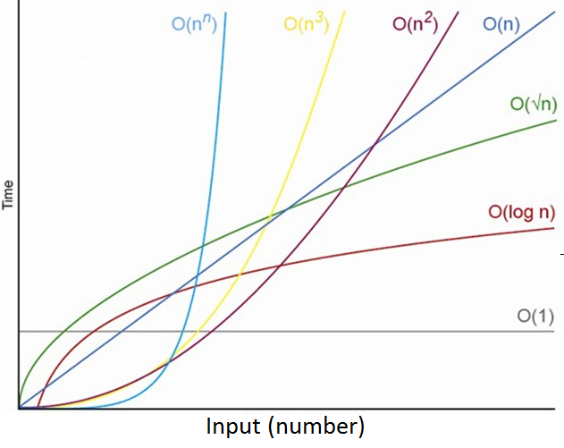
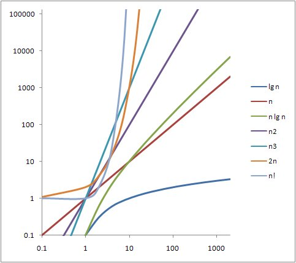

# Teoria

## Złożoność obliczeniowa algorytmów

- pamięciowa - ilość pamięci wykorzystywanej do realizacji algorytmu, zależy od typów i rozmiarów danych wykorzystanych w programie
- czasowa - czas wykonania algorytmu wyrażany zazwyczaj w ilości tzw. operacji wiodących (dla algorytmów porządkujących, przeszukujących - ilość operacji porównania, dla algorytmów numerycznych - ilość operacji +, \*, ..)

W określaniu typu złożoności zakłada się pesymistyczną złożoność, tzn. taką jaką algorytm będzie realizował dla danych najbardziej niekorzystnych.

---

## Klasa złożoności obliczeniowej

Analizując algorytmy korzysta się z tzw. klasy złożoności obliczeniowej, która określa jak od danych wejściowych (n) zależy liczba operacji wiodących. Do tego celu możemy posłużyć się notacją O "duże" (o mikron), np.:

- jeśli dla n danych wejściowych wykonujemy w najgorszym przypadku około n operacji (np. 2n+1, n-1, itd) to wówczas mamy do czynienia z algorytmem o klasie złożoności liniowej, zapisujemy: O(n)
- jeśli dla n danych wykonujemy w najgorszym przypadku 2n2+n+10 operacji to mamy do czynienia również z algorytmem o klasie złożoności wielomianowej, a dokładnie - kwadratowej, co zapisujemy O(n2) (pomijamy współczynniki wielomianów, pomijamy wkład od niższych potęg

Przykłady klas złożoności obliczeniowej w notacji O:

- O(1) - złożoność stała, gdy czas wykonania algorytmu jest stały i niezależny od rozmiaru danych wejściowych (najszybszy)
- O(log(n)) - złożoność logarytmiczna (np. wyszukiwanie binarne) (bardzo szybki)
- O(n) - złożoność liniowa (np. wyszukiwanie liniowe) (szybki)
- O(nlog(n)) - złożoność liniowo-logarytmiczna, quasiliniowa (np. sortowanie przez scalanie) (szybki)
- O(n2)- złożoność kwadratowa (np. sortowanie bąbelkowe) (niezbyt szybki)
- O(nk)- złożoność wielomianowa (n, n2, n3, ...)  (wolny)
- O(2n)- złożoność wykładnicza
- O(n!) - złożoność wykładnicza, ponieważ n!&gt;2n już od n=4 (np. problem komiwojażera)

źródło [http://ilyoan.tistory.com, medium.com]
