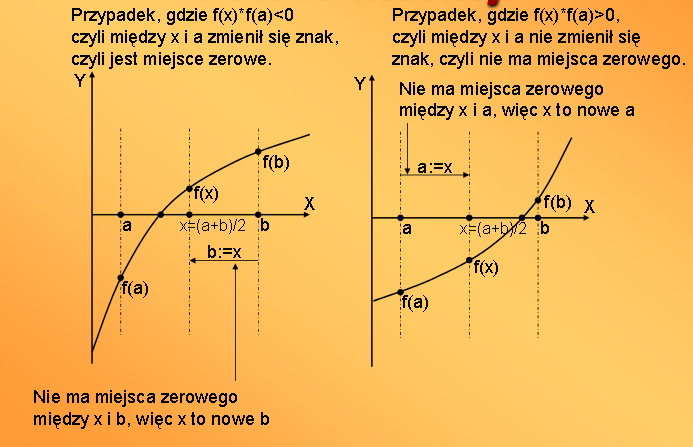

# Bisekcja

## Bisekcja **- inaczej jest zwana metodą połowienia przedziału lub równych podziałów**

Wyznaczenie miejsca zerowego funkcji ciągłej

Aby zastosować metodę bisekcji dla funkcji f w przedziale [a,b] konieczne jest:

- by funkcja była ciągła na przedziale [a,b]
- funkcja przyjmowała różne znaki na końcach przedziału, czyli *f(a)\*f(b)*&lt;0

**POLECENIE:**Napisz funkcję f, która zwraca wartość funkcji x\*x-4, następnie napisz funkcję bisekcja, która znajdzie miejsce zerowe funkcji f w przedziale [a,b] z dokładnością d. Wywołaj ją dla:

- a=1, b=5 i dokładności 0.01
- następnie dla funkcji g(x)=sin(2\*x) znajdź miejsce zerowe w przedziale [5,10] z dokładnością 0.01
