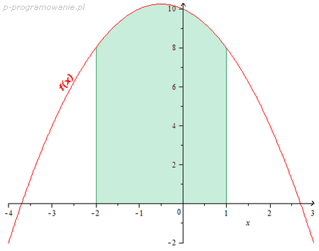
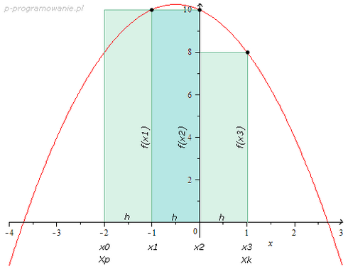
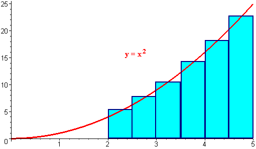
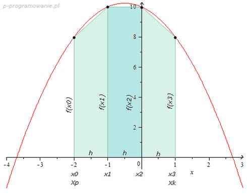
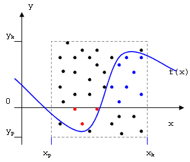

# Całka numeryczna

## Całkowanie numeryczne - znajdowanie pola pod (nad) wykresem funkcji w zadanym przedziale.

Polecenie: Znajdź pole pod wykresem funkcji f(x)=-x\*x-x+10 w przedziale [-2,1]

Poniższy algorytm jest algorytmem przybliżonym - nie daje wyników dokładnych, ale przybliżone.

### Metoda prostokątów

wersja 2. Z nadmiarem i niedomiarem

### Metoda trapezów

### 

### Co należy zrobić, by w poniższych metodach zwiększyć dokładność? Która z metod jest dokładniejsza?

## Całka numeryczna - metoda Monte Carlo

Metoda Monte Carlo polega na tym, że losujemy n punktów i sprawdzamy, czy znalazły się w obszarze całki, czy nie (czy znalazły się pod/nad wykresem).

jeśli na ***n*** wylosowanych punktów ***k*** znalazło się w obszarze, to łatwo stwierdzić, że całka stanowi ***k/n*** pola całego obszaru, z którego losowaliśmy punkty.

